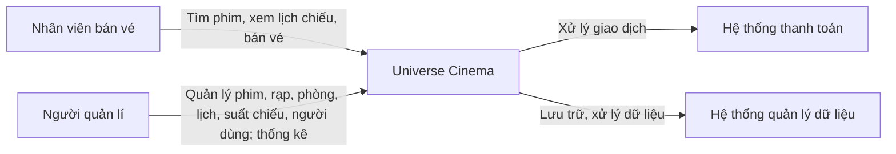

# Software Requirements Specification (SRS) – Universe Cinema

| Thuộc tính | Nội dung |
|---|---|
| Hệ thống | Universe Cinema – Hệ thống quản lý rạp chiếu phim |
| Loại tài liệu | SRS – **bản biên tập lại cho portfolio** |
| Căn cứ | [SRS] "Đặc tả yêu cầu ứng dụng – V1.0" (08/2024) và [DT] "Phát triển ứng dụng – Đề tài Hệ thống quản lí rạp chiếu phim" (19/08/2024) của nhóm học phần |
| Ngôn ngữ | Tiếng Việt |

> **Về bản biên tập này:** Tài liệu tái cấu trúc nội dung của hai tài liệu học phần theo bố cục SRS chuẩn, đánh mã yêu cầu để truy vết, và tách riêng phần đề xuất bổ sung. **Ý nghĩa nghiệp vụ gốc được giữ nguyên.** Mọi nội dung không có trong nguồn đều được gắn nhãn `INFERRED`, `PROPOSED` hoặc `TBD`.

---

## 1. Introduction

### 1.1 Mục đích

Hệ thống quản lý rạp chiếu phim Universe Cinema hỗ trợ quản lý thông tin và hoạt động của rạp chiếu phim dễ dàng, hiệu quả hơn, thông qua các chức năng quản lý lịch chiếu, bán vé, quản lý phòng chiếu, theo dõi doanh thu và quản lý nhân viên. Hệ thống giúp việc điều hành rạp phim nhanh chóng, thuận tiện và chính xác hơn cho người quản lý và nhân viên rạp. *(SRS A.I)*

Tài liệu SRS được sử dụng cho nhóm phát triển ứng dụng. *(SRS A.II)*

### 1.2 Phạm vi

- Ứng dụng có giao diện trực quan, chức năng dễ sử dụng, được phát triển dựa trên quy trình nghiệp vụ thực tế tại rạp chiếu phim. *(SRS A.II)*
- Cung cấp giải pháp quản lý cho hoạt động của rạp: quản lý lịch chiếu, bán vé, theo dõi doanh thu. *(SRS A.II)*
- Hướng đến quy mô rạp chiếu phim **từ nhỏ đến trung bình**, bao gồm hoạt động chiếu phim và bán vé. *(SRS A.II)*

Chi tiết In Scope / Out of Scope: xem [Project Overview](../01_Project_Overview/Project_Overview.md#5-phạm-vi).

### 1.3 Định nghĩa, thuật ngữ

> Mục thuật ngữ trong [SRS] A.III **để trống**. Bảng dưới đây do portfolio bổ sung (PROPOSED), dựa trên cách dùng từ trong tài liệu gốc.

| Thuật ngữ | Giải thích | Trạng thái |
|---|---|---|
| Phim | Tác phẩm điện ảnh được quản lý trên hệ thống (tên, thể loại, đạo diễn, diễn viên, thời lượng…) | INFERRED |
| Rạp chiếu phim | Địa điểm kinh doanh, có tên, địa chỉ, số điện thoại | INFERRED |
| Phòng chiếu | Phòng trong rạp, có sơ đồ ghế và số lượng ghế | INFERRED |
| Suất chiếu | Một lần chiếu của một phim tại một phòng chiếu, có giờ bắt đầu và giờ kết thúc | INFERRED |
| Lịch chiếu | Chưa được định nghĩa khác biệt với suất chiếu (ISS-07) | TBD |
| Dịch vụ đi kèm / sản phẩm bổ sung | Bắp rang, nước uống, snack, combo bán kèm vé | INFERRED |
| UC | Use Case | – |
| FR / NFR / BR | Functional Requirement / Non-functional Requirement / Business Rule | – |

### 1.4 Tài liệu tham khảo

| # | Tài liệu | Ghi chú |
|---|---|---|
| 1 | [SRS] Nhom07_3_ApplicationDevelopment_SRS.docx – Đặc tả yêu cầu ứng dụng V1.0 | Tài liệu học phần (không công khai bản gốc do chứa thông tin cá nhân) |
| 2 | [DT] Nhom07_DacTa.docx – Đề tài Hệ thống quản lí rạp chiếu phim | Tài liệu học phần (không công khai bản gốc) |

---

## 2. System Overview

Trong hệ thống Universe Cinema, người dùng chính là nhân viên rạp và người quản trị hệ thống. Mỗi nhân viên có một tài khoản cá nhân lưu thông tin cá nhân và quyền hạn. *(DT II)*

Hệ thống quản lý nhiều phim. Mỗi phim có thể chiếu ở nhiều suất chiếu trong ngày hoặc qua nhiều ngày. Mỗi suất chiếu liên kết với một phòng chiếu cụ thể và có số lượng vé nhất định. Một phòng chiếu có thể phục vụ nhiều phim và suất chiếu khác nhau. *(SRS A.I; DT II)*

Nhân viên là người thực hiện đặt vé cho khách hàng. Hệ thống tự động kiểm tra số ghế còn trống và không cho bán vượt quá số ghế có sẵn. Hệ thống không cho phép hoàn vé sau khi đã thanh toán. *(SRS A.I – **Đã xác nhận** bởi chủ portfolio ngày 23/11/2026. Hệ thống là phần mềm bán vé tại quầy; không hoàn, đổi hay hủy vé.)*

Ngoài quản lý phim, phòng chiếu, suất chiếu, hệ thống còn hỗ trợ theo dõi và quản lý đơn đặt vé, cung cấp báo cáo doanh thu và thống kê số vé bán ra. Dữ liệu vé bán ra được tổng hợp để phân tích doanh thu và hiệu suất, giúp tối ưu lịch chiếu và phân bổ phòng chiếu. *(SRS A.I; DT II)*

**Hệ thống con hỗ trợ** *(SRS A.II)*: Hệ thống thanh toán; Hệ thống quản lý dữ liệu.

*Sơ đồ ngữ cảnh trên do portfolio dựng từ SRS A.II và B.II (INFERRED). Tài liệu học phần không có sơ đồ ngữ cảnh.*

---

## 3. Actors and User Roles

| Actor | Mô tả | Use Case chính | Nguồn |
|---|---|---|---|
| Nhân viên bán vé | Thực hiện giao dịch bán vé, hỗ trợ khách hàng đặt vé và chọn suất chiếu; kiểm tra tình trạng vé, xác nhận đặt chỗ, xử lý thanh toán | UC-001 → UC-004 | SRS B.II; UCD |
| Người quản lí | Quản lý toàn bộ hệ thống: cấu hình, bảo trì, quản lý lịch chiếu, theo dõi doanh thu, phân tích dữ liệu; có quyền với tất cả thông tin và chức năng | UC-001, UC-005 → UC-013 | SRS B.II; UCD |

**Nhóm người dùng theo SRS A.II** (chưa khớp với bảng actor – ISS-05):

| Nhóm | Mô tả theo SRS A.II |
|---|---|
| Nhân viên bán vé | Bán vé, quản lý đặt chỗ, xử lý giao dịch thanh toán |
| Nhân viên quản lý phòng chiếu | Theo dõi tình trạng phòng chiếu, phân bổ phòng cho suất chiếu, quản lý thiết bị |
| Quản lý rạp phim | Quản lý lịch chiếu, bán vé, theo dõi doanh thu, quản lý nhân viên, phân tích dữ liệu thống kê |

Danh mục chi tiết: [Use Case Catalog](../03_Use_Case/Use_Case_Catalog.md#1-danh-sách-tác-nhân-actors).

---

## 4. Functional Requirements

35 yêu cầu chức năng (FR-001 → FR-035), chia 9 nhóm. Đặc tả đầy đủ từng yêu cầu (Description, Actor, Preconditions, Inputs/Outputs, Priority, Source Reference, Verification Status): **[Functional Requirements](Functional_Requirements.md)**.

| Nhóm | Requirement IDs | Use Case |
|---|---|---|
| A. Truy cập hệ thống | FR-001, FR-002 | UC-001 |
| B. Tra cứu phim và lịch chiếu | FR-003 → FR-007 | UC-002, UC-003 |
| C. Bán vé | FR-008 → FR-012 | UC-004 |
| D. Quản lý phim | FR-013 → FR-016 | UC-005 → UC-007 |
| E. Quản lý rạp, phòng chiếu, ghế | FR-017 → FR-022 | UC-008, UC-009 |
| F. Quản lý lịch chiếu, suất chiếu | FR-023, FR-024 | UC-010, UC-011 |
| G. Người dùng và phân quyền | FR-025, FR-030, FR-035 | UC-012 |
| H. Báo cáo và thống kê | FR-026 → FR-029 | UC-013 |
| I. Có mô tả nhưng chưa có UC | FR-031 → FR-034 | – |

**Tổng hợp trạng thái:** 28 VERIFIED · 1 INFERRED · 4 TBD · 2 OUT OF SCOPE. (Một số yêu cầu VERIFIED vẫn có chi tiết cần xác minh, xem cột ghi chú trong tài liệu chi tiết.)

---

## 5. Non-functional Requirements

| ID | Yêu cầu | Nguồn |
|---|---|---|
| NFR-001 | Giao diện thân thiện, dễ sử dụng | DT III; SRS A.I, A.II |
| NFR-002 | Người dùng mới sử dụng hiệu quả mà không cần đào tạo chuyên sâu | SRS A.II |
| NFR-003 | Bảo mật cao; kiểm tra, xác thực quyền truy cập | DT III; SRS A.I.1.a |
| NFR-004 | Chạy ổn định | DT III; SRS A.I |
| NFR-005 | Dễ bảo trì và nâng cấp | DT III |
| NFR-006 | Quy mô rạp nhỏ đến trung bình | SRS A.II |
| NFR-007 | Kết nối hệ thống thanh toán | SRS A.II |
| NFR-008 | Kết nối hệ thống quản lý dữ liệu | SRS A.II |

Chi tiết và phiên bản đo lường được (PROPOSED): [Non-functional Requirements](Non_Functional_Requirements.md).

---

## 6. Business Rules

| ID | Quy tắc | Trạng thái |
|---|---|---|
| BR-001 | Nhân viên là người thực hiện đặt vé cho khách hàng | VERIFIED – đã xác nhận |
| BR-002 | Không bán vé vượt quá số ghế còn trống | VERIFIED |
| BR-003 | Không hoàn vé sau khi đã thanh toán (không đổi suất chiếu) | VERIFIED – đã xác nhận |
| BR-004 | Không hủy vé sau khi đã xác nhận và thanh toán | VERIFIED – đã xác nhận |
| BR-005 | Mỗi suất chiếu liên kết một phòng chiếu cụ thể, có số lượng vé nhất định | VERIFIED |
| BR-006 | Một phòng chiếu phục vụ nhiều phim và suất chiếu | VERIFIED |
| BR-007 | Một phim có nhiều suất chiếu, tại nhiều phòng, qua nhiều ngày | VERIFIED |
| BR-008 | Tự động cập nhật số ghế còn trống sau mỗi giao dịch | VERIFIED |
| BR-009 | Phải đăng nhập trước khi dùng chức năng nghiệp vụ | VERIFIED |
| BR-010 | Chỉ thực hiện chức năng đã được phân quyền | VERIFIED |
| BR-011 | Đăng nhập sai → thông báo và nhập lại | VERIFIED |
| BR-012 | Người quản lí có quyền với tất cả thông tin và chức năng | VERIFIED |

Chi tiết và quy tắc đề xuất BR-P01 → BR-P06: [Business Rules](Business_Rules.md).

---

## 7. Use Case References

| Tài liệu | Nội dung |
|---|---|
| [Use Case Catalog](../03_Use_Case/Use_Case_Catalog.md) | Danh sách 13 use case, actor, chức năng chưa có UC |
| [Use Case Specification](../03_Use_Case/Use_Case_Specification.md) | Đặc tả từng UC; phân tách luồng gốc / suy ra / đề xuất |
| [Use Case Diagram](../03_Use_Case/Use_Case_Diagram.md) | Sơ đồ gốc và bản vẽ lại PlantUML |
| [Activity Diagram](../04_Business_Process/Activity_Diagram.md) | Quy trình đăng nhập, bán vé, thiết lập suất chiếu |
| [Entity Relationship Diagram](../05_Data_Model/Entity_Relationship_Diagram.md) | Mô hình dữ liệu đề xuất (PROPOSED) |
| [UI Wireframes](../06_UI_Wireframes/README.md) | 8 mockup gốc |
| [Requirements Traceability Matrix](../07_Traceability/Requirements_Traceability_Matrix.md) | Ma trận FR ↔ UC ↔ BR ↔ Mockup |

---

## 8. Assumptions and Constraints

**Ràng buộc (từ nguồn):**

- Quy mô rạp nhỏ đến trung bình (SRS A.II).
- Hệ thống phụ thuộc hai hệ thống con: thanh toán và quản lý dữ liệu (SRS A.II).
- Không hoàn vé, không đổi suất, không hủy vé sau thanh toán (SRS A.I; đã xác nhận 23/11/2026).
- Hệ thống là phần mềm cho nhân viên bán vé tại quầy; khách hàng không trực tiếp sử dụng hệ thống (đã xác nhận 23/11/2026).

**Các mục còn trống trong nguồn:** SRS B.IV "Các điều kiện phụ thuộc" (phần cứng, mạng, phần mềm, hệ quản trị CSDL, công cụ phát triển) để trống theo mẫu. Bản biên tập này **không bổ sung** thông tin công nghệ.

**Giả định đang áp dụng:** A-01 → A-05, xem [Assumptions and Open Questions](../08_Review/Assumptions_and_Open_Questions.md#2-giả-định-đang-áp-dụng-trong-portfolio).

---

## 9. Open Questions

Có **22 vấn đề** (ISS-01 → ISS-22) và **13 câu hỏi** (Q-01 → Q-13). Ngày 23/11/2026 đã giải quyết **ISS-01** (hệ thống bán vé tại quầy) và **ISS-02** (không hoàn/đổi/hủy vé). Các vấn đề mở ảnh hưởng lớn nhất còn lại:

1. **ISS-07** – Lịch chiếu khác suất chiếu thế nào?
2. **ISS-12** – "Người dùng" trong UC-012 là nhân viên hay khách hàng?
3. **ISS-03** – Quản lý rạp có chức năng xóa không?
4. **ISS-22** – Chọn ghế cụ thể hay chỉ chọn số lượng vé?

Danh sách đầy đủ: [Assumptions and Open Questions](../08_Review/Assumptions_and_Open_Questions.md).
