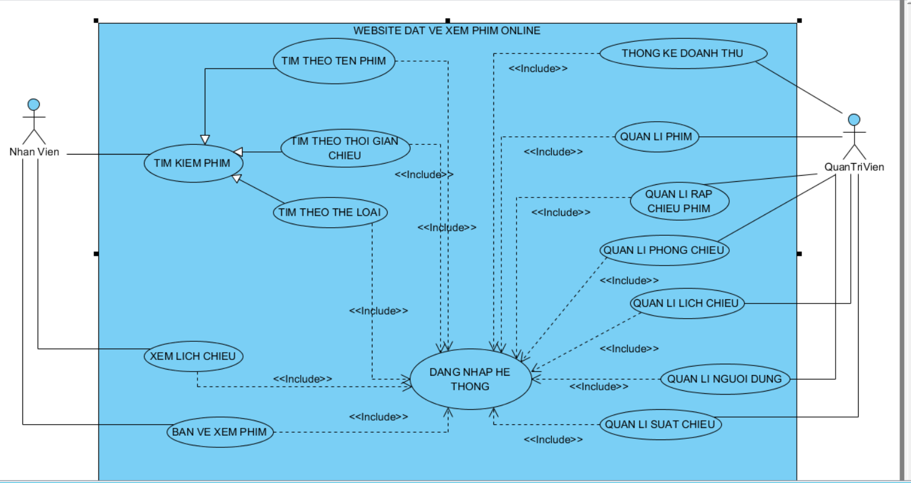
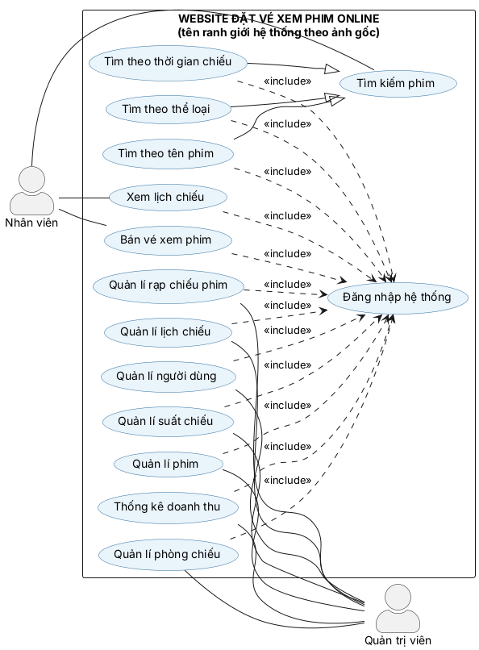

# Use Case Diagram – Sơ đồ Use Case

## 1. Sơ đồ gốc của học phần (VERIFIED)

Ảnh dưới đây được trích nguyên bản từ tài liệu học phần ([SRS] mục B.I "Mô hình Use case" và [DT] mục IV "Mô hình hóa chức năng – Sơ đồ Usecase"; hai ảnh giống hệt nhau). Ảnh không bị chỉnh sửa.

### Thành phần trên sơ đồ gốc

| Loại | Thành phần |
|---|---|
| Ranh giới hệ thống | "WEBSITE DAT VE XEM PHIM ONLINE" |
| Actor | Nhan Vien (Nhân viên), QuanTriVien (Quản trị viên) |
| Use case của Nhân viên | Tìm kiếm phim; Xem lịch chiếu; Bán vé xem phim |
| Use case con (generalization → Tìm kiếm phim) | Tìm theo tên phim; Tìm theo thời gian chiếu; Tìm theo thể loại |
| Use case của Quản trị viên | Thống kê doanh thu; Quản lí phim; Quản lí rạp chiếu phim; Quản lí phòng chiếu; Quản lí lịch chiếu; Quản lí người dùng; Quản lí suất chiếu |
| Use case dùng chung | Đăng nhập hệ thống (được «include» bởi các use case nghiệp vụ) |

## 2. Bản vẽ lại bằng PlantUML (bản sao trung thực)

Để dễ chỉnh sửa và quản lý phiên bản, sơ đồ gốc được **vẽ lại bằng PlantUML**. Bản vẽ giữ nguyên actor, use case và quan hệ như ảnh gốc, chỉ bổ sung dấu tiếng Việt cho tên. **Không thêm hay bớt thành phần nghiệp vụ nào.**

- Mã nguồn: [`assets/diagrams/use_case_diagram.puml`](../assets/diagrams/use_case_diagram.puml)
- Ảnh render: [`assets/diagrams/use_case_diagram_redrawn.png`](../assets/diagrams/use_case_diagram_redrawn.png). Ảnh được render bằng PlantUML 1.2024.7 với layout `smetana`, mã nguồn đã qua kiểm tra cú pháp (`-checkonly`).

> GitHub không tự hiển thị PlantUML trong Markdown, nên repo dùng ảnh PNG đã render. Portfolio **không dùng Mermaid** cho sơ đồ use case, vì Mermaid không có ký pháp UML Use Case chuẩn.

## 3. Đối chiếu sơ đồ với danh mục Use Case (SRS B.III)

| Trên sơ đồ | Trong danh mục | Nhận xét |
|---|---|---|
| Đăng nhập hệ thống | UC-001 | Khớp. Trên sơ đồ không có đường nối trực tiếp từ actor tới use case này. |
| Tìm kiếm phim (+3 UC con) | UC-002 | Khớp. 3 UC con chỉ có trên sơ đồ. |
| Xem lịch chiếu | UC-003 | Khớp |
| Bán vé xem phim | UC-004 | Khớp |
| Quản lí phim | UC-005, UC-006, UC-007 | Danh mục tách thành Thêm/Sửa/Xóa phim; sơ đồ gộp làm một (ISS-08) |
| Quản lí rạp chiếu phim | UC-008 | Khớp |
| Quản lí phòng chiếu | UC-009 | Khớp |
| Quản lí lịch chiếu | UC-010 | Khớp |
| Quản lí suất chiếu | UC-011 | Khớp |
| Quản lí người dùng | UC-012 | Khớp |
| Thống kê doanh thu | UC-013 | Khớp |

## 4. Nhận xét review sơ đồ

Đây là các quan sát của portfolio khi rà soát lại sơ đồ. Chúng **không phải** chỉnh sửa đã thực hiện trong học phần.

| # | Quan sát | Liên quan |
|---|---|---|
| 1 | Tên ranh giới "Website đặt vé xem phim online" không khớp với mô tả trong SRS (nhân viên bán vé cho khách tại rạp) và tên hệ thống "Universe Cinema – Hệ thống quản lý rạp chiếu phim". Chủ portfolio đã xác nhận hệ thống là phần mềm bán vé tại quầy, nên tên ranh giới trên sơ đồ gốc chưa chính xác. | ISS-01 (đã giải quyết) |
| 2 | Đăng nhập được mô hình là use case được «include» bởi mọi use case khác. Trong thực hành UML, đăng nhập thường được xem là *tiền điều kiện* hơn là một bước bắt buộc của từng use case. | ISS-16 |
| 3 | Các chức năng "Xem chi tiết phim", "Phân quyền", "Quản lý đơn đặt vé", "Quản lý khuyến mãi" có mô tả trong tài liệu nhưng chưa có trên sơ đồ. | ISS-11 |
| 4 | Sơ đồ có 2 actor, trong khi SRS A.II liệt kê 3 nhóm người dùng. | ISS-05 |

## 5. ⚠️ Đề xuất bổ sung – Hướng hoàn thiện sơ đồ (PROPOSED)

Phần này **chưa được vẽ thành sơ đồ** vì cần xác nhận phạm vi trước (xem [Assumptions and Open Questions](../08_Review/Assumptions_and_Open_Questions.md)):

1. Đổi tên ranh giới hệ thống thành "Universe Cinema – Hệ thống quản lý rạp chiếu phim" (ISS-01 đã xác nhận: phần mềm bán vé tại quầy).
2. Thể hiện "Quản lí phim" là use case cha, với «extend» hoặc tách rõ Thêm/Sửa/Xóa cho khớp danh mục.
3. Bổ sung các use case còn thiếu nếu được xác nhận thuộc phạm vi: Xem chi tiết phim, Phân quyền người dùng, Quản lý đơn đặt vé.
4. Thêm actor phụ "Hệ thống thanh toán" cho UC-004.
