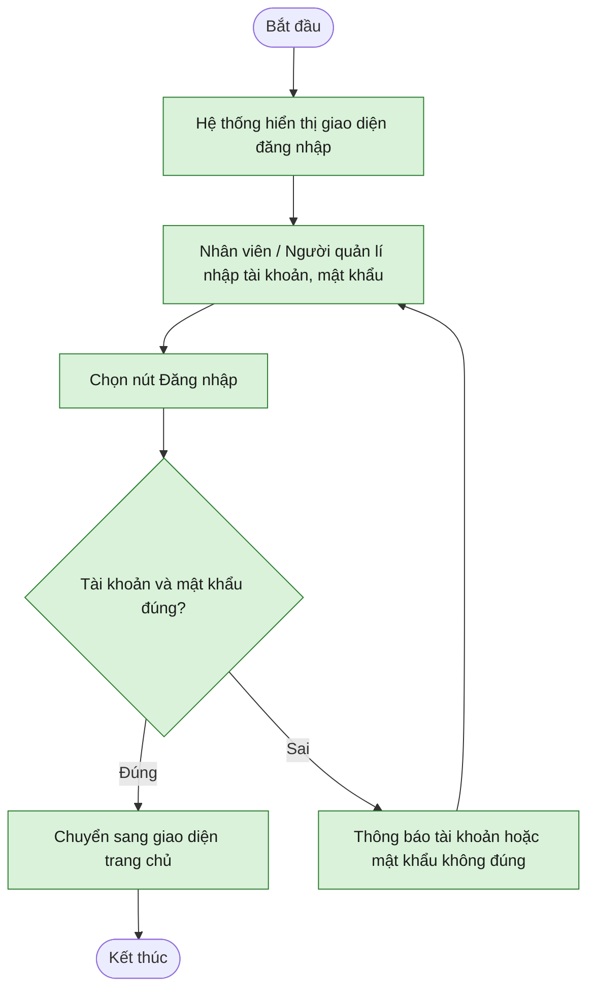
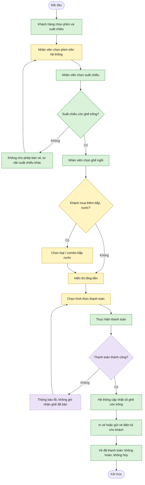
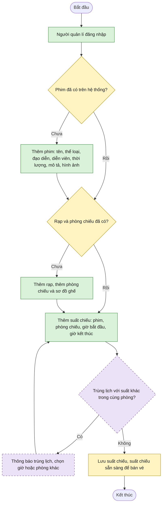

# Activity Diagram – Quy trình nghiệp vụ

> ⚠️ **Lưu ý về nguồn gốc:** Tài liệu học phần **không có Activity Diagram**. Các mục "Biểu đồ" trong SRS mục C đều để trống. Các sơ đồ dưới đây được **dựng mới cho portfolio** từ mô tả nghiệp vụ trong [SRS]/[DT] và mockup [MU]. Chúng **không phải sản phẩm đã thực hiện trong học phần**.
>
> Mỗi bước được tô màu theo mức độ căn cứ:
>
> | Màu | Ý nghĩa |
> |---|---|
> | 🟩 Xanh lá | **VERIFIED** – bước có trong tài liệu gốc |
> | 🟨 Vàng | **INFERRED** – thứ tự hoặc bước suy ra từ mockup/tài liệu, chưa xác nhận |
> | 🟪 Tím, viền nét đứt | **PROPOSED** – đề xuất bổ sung |
>
> Sơ đồ dùng Mermaid `flowchart` và hiển thị trực tiếp trên GitHub.

## 1. Danh sách quy trình nghiệp vụ được xác định

| Mã | Quy trình | Actor | Căn cứ | Mức căn cứ |
|---|---|---|---|---|
| BP-01 | Đăng nhập hệ thống | Nhân viên bán vé, Người quản lí | SRS C.I (UC001) – có luồng chính và luồng phụ | Đủ để dựng sơ đồ |
| BP-02 | Bán vé tại quầy | Nhân viên bán vé | SRS A.I, A.I.1.d; DT II.1.e; MU `wf02`–`wf04` | Đủ để dựng; thứ tự suy ra từ mockup |
| BP-03 | Thiết lập dữ liệu chiếu phim (phim → phòng → suất chiếu) | Người quản lí | SRS A.I.2; quan hệ dữ liệu ở SRS A.I, DT II | Chỉ có chức năng rời rạc; trình tự là đề xuất |
| BP-04 | Hoàn vé / đổi suất chiếu | Nhân viên | DT II | **Không dựng sơ đồ**: đã xác nhận ngoài phạm vi (ISS-02) |
| BP-05 | Thống kê doanh thu | Người quản lí | SRS A.I.2.g | Không dựng: chưa có luồng nghiệp vụ trong nguồn |

---

## 2. BP-01 – Đăng nhập hệ thống

**Căn cứ:** SRS mục C.I – UC001, luồng chính bước 1–5 và luồng phụ 4.1–4.2. Toàn bộ bước là VERIFIED. Điểm rẽ nhánh "Thông tin hợp lệ?" là cách biểu diễn điều kiện dẫn tới luồng phụ 4.1.

---

## 3. BP-02 – Bán vé tại quầy

**Căn cứ:**

- VERIFIED: nhân viên đặt vé cho khách, chọn suất chiếu và ghế, thanh toán (SRS A.I, A.I.1.d); không bán vượt số ghế trống (SRS A.I); in vé hoặc gửi vé điện tử (SRS A.I.1.d); cập nhật số ghế còn trống (SRS A.I.1.d).
- INFERRED: thứ tự 3 bước "Chọn phim → Chọn ghế → Bắp/Nước" và bước "Chọn hình thức thanh toán" lấy từ mockup `wf02`–`wf04`. Bước chọn bắp nước có trong DT II.1.e và mockup, nhưng không có trong mô tả UC004 của SRS.
- PROPOSED: nhánh xử lý khi thanh toán thất bại.

> **Điểm cần xác minh:** mockup `wf02` chưa thể hiện rõ bước chọn suất chiếu (ISS-22). Hiện có hai mô tả khác nhau là "chọn số lượng vé" (SRS A.I) và "chọn ghế cụ thể" (SRS A.I.1.d, mockup). Quy tắc "không hoàn, không hủy" đã được chủ portfolio xác nhận ngày 23/11/2026 (ISS-02).

---

## 4. BP-03 – Thiết lập dữ liệu chiếu phim (PROPOSED)

> ⚠️ **Đề xuất bổ sung.** Các chức năng trong sơ đồ (thêm phim, thêm phòng chiếu, quản lý ghế, thêm suất chiếu) đều VERIFIED (SRS A.I.2). Tuy nhiên tài liệu gốc **không mô tả trình tự** giữa chúng. Trình tự dưới đây được suy ra từ quan hệ dữ liệu: suất chiếu cần có phim và phòng chiếu (BR-005, BR-007). Kiểm tra trùng lịch là quy tắc đề xuất BR-P01.

