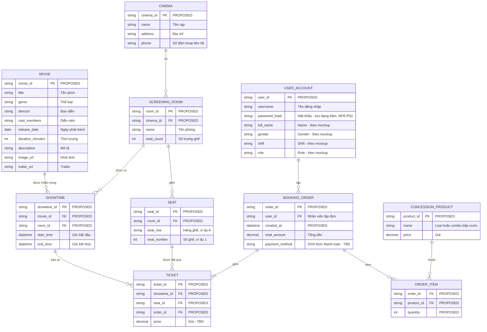

# Entity Relationship Diagram – Mô hình dữ liệu

> ⚠️ **ERD này là PROPOSED (Đề xuất bổ sung).**
>
> - Tài liệu học phần **không có schema cơ sở dữ liệu**. Mục "V. Sơ đồ lớp" trong [DT] chỉ có tiêu đề, không có nội dung. Mục "Các điều kiện phụ thuộc" trong [SRS] (hệ quản trị CSDL) còn để trống theo mẫu.
> - ERD dưới đây là **mô hình khái niệm đề xuất cho portfolio**, dựng từ các thực thể và quan hệ được mô tả bằng lời trong tài liệu.
> - Portfolio **không khẳng định** bảng, cột, khóa hay quan hệ nào đã được triển khai trong học phần.
> - Kiểu dữ liệu chỉ mang tính minh họa.

## 1. Căn cứ từ tài liệu gốc

Các đoạn mô tả quan hệ dữ liệu trong nguồn:

- DT II: *"Hệ thống kết nối các thực thể như rạp chiếu phim, phim, suất chiếu, phòng chiếu, và vé… Một rạp chiếu phim có thể chiếu nhiều phim, với mỗi phim có nhiều suất chiếu diễn ra tại các phòng chiếu khác nhau. Hệ thống theo dõi số vé bán cho từng suất chiếu… Phòng chiếu có thể phục vụ cho nhiều suất chiếu và hệ thống quản lý số lượng ghế bán được tại mỗi phòng."*
- SRS A.I: *"Mỗi suất chiếu liên kết với một phòng chiếu cụ thể và có số lượng vé nhất định. Một phòng chiếu có thể phục vụ cho nhiều phim và suất chiếu khác nhau."*
- SRS A.I.2.c / DT II.2.d: quản lý ghế ngồi trong từng phòng chiếu.
- SRS A.I / DT II: đơn đặt vé / đơn hàng; tài khoản cá nhân của nhân viên; sản phẩm bổ sung (bắp rang, nước uống).

## 2. Thực thể và mức căn cứ

| Thực thể (đề xuất) | Tên nghiệp vụ | Thuộc tính có trong nguồn | Nguồn | Trạng thái thực thể |
|---|---|---|---|---|
| `CINEMA` | Rạp chiếu phim | Tên rạp, địa chỉ, số điện thoại liên hệ | SRS A.I.2.b; DT II.2.c | VERIFIED |
| `SCREENING_ROOM` | Phòng chiếu | Tên phòng, số lượng ghế | SRS A.I.2.c; DT II.2.d | VERIFIED |
| `SEAT` | Ghế ngồi | Mã ghế dạng hàng + số (A1…F15, theo mockup) | SRS A.I.2.c; MU `wf03` | VERIFIED (thực thể); thuộc tính INFERRED |
| `MOVIE` | Phim | Tên phim, thể loại, đạo diễn, diễn viên, ngày phát hành, thời lượng, mô tả, hình ảnh, trailer | SRS A.I.2.a; DT II.2.b | VERIFIED |
| `SHOWTIME` | Suất chiếu | Giờ bắt đầu, giờ kết thúc, phòng chiếu | SRS A.I.2.e; DT II.2.f | VERIFIED |
| `TICKET` | Vé | – (không có thuộc tính trong nguồn) | DT II; SRS A.I | VERIFIED (thực thể) |
| `BOOKING_ORDER` | Đơn đặt vé / đơn hàng / hóa đơn | – | SRS A.I; DT II; MU `wf04` ("In hóa đơn") | INFERRED |
| `CONCESSION_PRODUCT` | Sản phẩm bổ sung (bắp, nước, combo) | Loại / combo, giá | DT II.1.e; SRS A.I.2.g; MU `wf04` | INFERRED |
| `ORDER_ITEM` | Dòng sản phẩm bổ sung trong đơn | – | – | PROPOSED |
| `USER_ACCOUNT` | Tài khoản người dùng | Tên đăng nhập, mật khẩu; Name, Gender, Shift, Role (MU) | SRS A.I.1.a, C.I; MU `wf07` | VERIFIED (thực thể) |

**Chưa mô hình hóa** (cần xác nhận phạm vi trước): *Lịch chiếu* (khác suất chiếu thế nào – ISS-07), *Chương trình khuyến mãi* (ISS-11), *Thanh toán* (hệ thống con bên ngoài – NFR-007), *Khách hàng* (ISS-01, ISS-12).

## 3. Quan hệ và mức căn cứ

| Quan hệ | Bản số | Căn cứ | Trạng thái |
|---|---|---|---|
| CINEMA – SCREENING_ROOM | 1 – n | DT I/II: "rạp chiếu phim lớn với nhiều phòng chiếu", "các phòng chiếu khác nhau" | INFERRED |
| SCREENING_ROOM – SEAT | 1 – n | SRS A.I.2.c: "ghế ngồi trong từng phòng chiếu" | VERIFIED |
| MOVIE – SHOWTIME | 1 – n | SRS A.I; DT II: "mỗi phim có nhiều suất chiếu" | VERIFIED |
| SCREENING_ROOM – SHOWTIME | 1 – n | SRS A.I: "mỗi suất chiếu liên kết với một phòng chiếu cụ thể"; "phòng chiếu có thể phục vụ nhiều… suất chiếu" | VERIFIED |
| SHOWTIME – TICKET | 1 – n | DT II: "theo dõi số vé bán cho từng suất chiếu" | VERIFIED |
| SEAT – TICKET | 1 – n (mỗi vé 1 ghế) | SRS A.I.1.d: chọn ghế ngồi khi bán vé | INFERRED |
| BOOKING_ORDER – TICKET | 1 – n | – | PROPOSED |
| BOOKING_ORDER – ORDER_ITEM – CONCESSION_PRODUCT | 1 – n – 1 | – | PROPOSED |
| USER_ACCOUNT – BOOKING_ORDER | 1 – n (nhân viên lập đơn) | SRS A.I: nhân viên thực hiện đặt vé | INFERRED |

## 4. ERD đề xuất (Mermaid)

## 5. Ràng buộc dữ liệu đề xuất (PROPOSED)

| # | Ràng buộc | Liên quan |
|---|---|---|
| 1 | `TICKET (showtime_id, seat_id)` là duy nhất: một ghế của một suất chiếu chỉ bán một lần | BR-002, BR-P03 |
| 2 | Số vé của một suất chiếu ≤ số ghế của phòng chiếu | BR-002, BR-005 |
| 3 | Suất chiếu trong cùng phòng không chồng lấn thời gian | BR-P01 |
| 4 | `end_time` > `start_time` | FR-024 |
