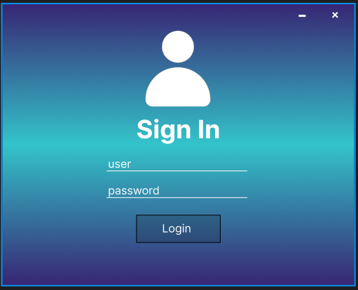
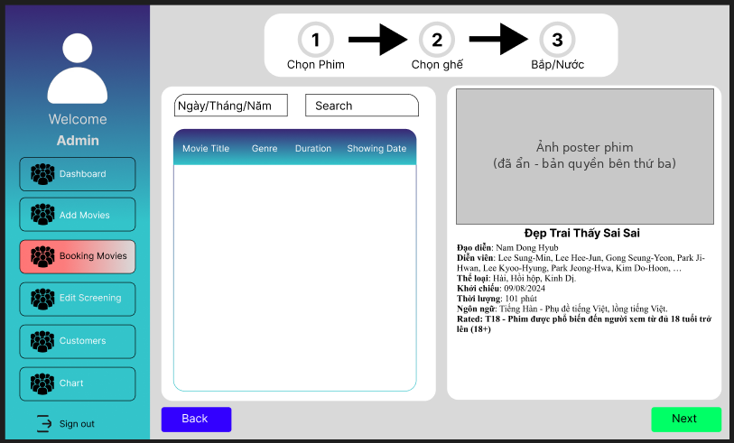
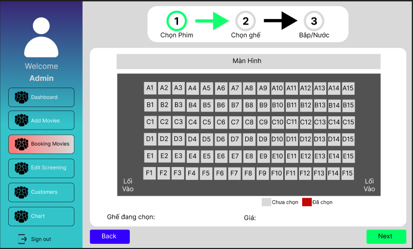
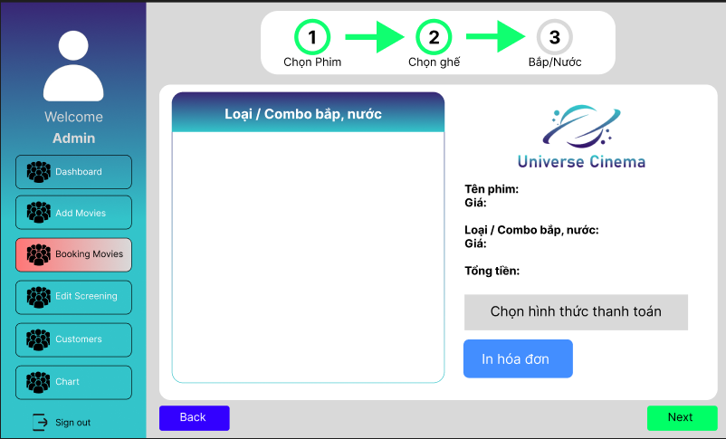
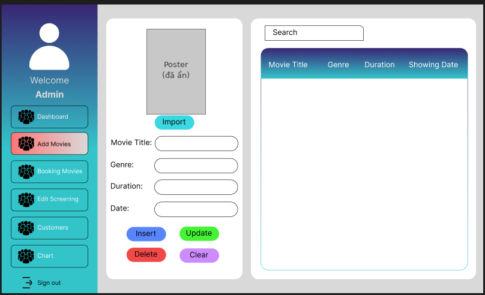
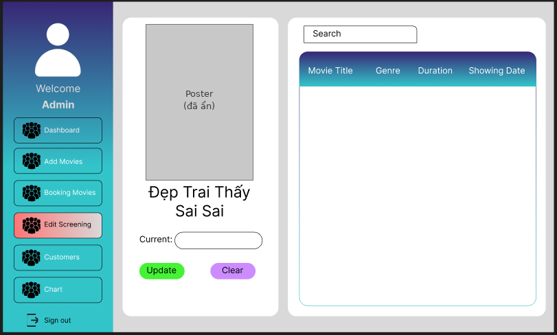
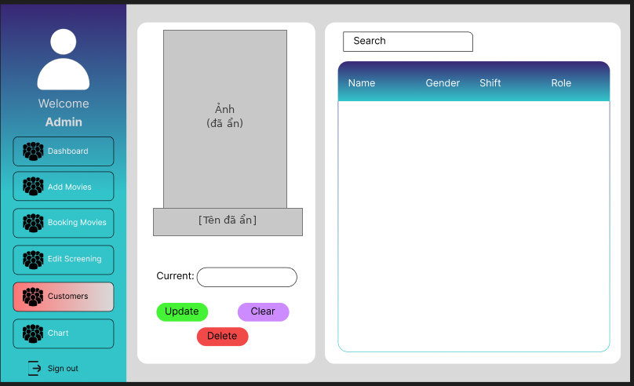
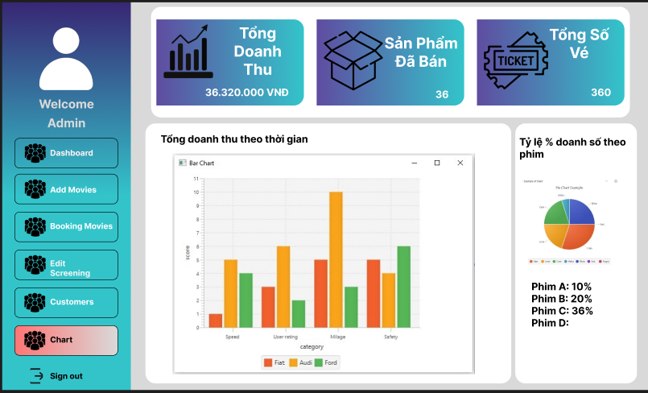

# UI Wireframes – Mockup giao diện

## 1. Nguồn gốc

8 màn hình dưới đây là **mockup gốc** được nhúng trong [SRS] mục A.I.1 "Chức năng nhân viên" và A.I.2 "Chức năng người quản lí" (VERIFIED). Portfolio **không tạo mới** wireframe nào.

> **Ghi chú:**
> - Tài liệu không ghi rõ thành viên nào thiết kế mockup. Portfolio **không khẳng định** đây là sản phẩm cá nhân của chủ portfolio.
> - Tài liệu không ghi công cụ thiết kế. Portfolio không suy đoán công cụ.
> - **Đã chỉnh sửa trước khi xuất bản:** ảnh poster phim thương mại (bản quyền của bên thứ ba) và tên một thành viên nhóm trên màn hình quản lý người dùng đã được che bằng khối xám có ghi chú "(đã ẩn)". Ngoài ra không chỉnh sửa gì khác.
> - Số liệu trên màn hình Dashboard (tổng doanh thu, số vé, % theo phim) và biểu đồ (nhãn "Fiat/Audi/Ford", "Speed/User rating…") là **dữ liệu minh họa của mockup**, không phải kết quả vận hành thực tế (ISS-20).

## 2. Danh sách màn hình

| Mã | Màn hình | Mục trong SRS | Use Case | Requirement |
|---|---|---|---|---|
| WF-01 | Đăng nhập (Sign In) | A.I.1.a | UC-001 | FR-001 |
| WF-02 | Bán vé – Bước 1: Chọn phim | A.I.1.b, A.I.1.c | UC-002, UC-003, UC-004 | FR-003, FR-005, FR-006, FR-008 |
| WF-03 | Bán vé – Bước 2: Chọn ghế | A.I.1.d | UC-004 | FR-008, FR-012 |
| WF-04 | Bán vé – Bước 3: Bắp/Nước và thanh toán | A.I.1.d | UC-004 | FR-009, FR-010, FR-011 |
| WF-05 | Quản lý phim (Add Movies) | A.I.2.a | UC-005, UC-006, UC-007 | FR-013 → FR-016 |
| WF-06 | Cập nhật suất chiếu (Edit Screening) | A.I.2.b → A.I.2.e* | UC-011 | FR-024 |
| WF-07 | Quản lý người dùng (Customers) | A.I.2.f | UC-012 | FR-025 |
| WF-08 | Dashboard / Thống kê doanh thu (Chart) | A.I.2.g | UC-013 | FR-026, FR-029 |

\* Trong SRS, cùng một ảnh WF-06 được dùng cho cả 4 mục Quản lý rạp, phòng chiếu, lịch chiếu và suất chiếu. Tài liệu **chưa có mockup riêng** cho quản lý rạp, phòng chiếu, ghế và lịch chiếu.

## 3. Màn hình

### WF-01 – Đăng nhập

Trường *user*, *password*, nút *Login*.

### WF-02 – Bán vé: Bước 1 – Chọn phim

Thanh tiến trình 3 bước. Ô Ngày/Tháng/Năm, ô Search, bảng phim (Movie Title, Genre, Duration, Showing Date), khung thông tin chi tiết phim, nút Back/Next.

### WF-03 – Bán vé: Bước 2 – Chọn ghế

Sơ đồ ghế 6 hàng (A–F) × 15 ghế, vị trí màn hình và lối vào, chú thích "Chưa chọn"/"Đã chọn", ghế đang chọn và giá.

### WF-04 – Bán vé: Bước 3 – Bắp/Nước và thanh toán

Danh sách loại/combo bắp nước, tóm tắt tên phim, giá, tổng tiền, nút "Chọn hình thức thanh toán" và "In hóa đơn".

### WF-05 – Quản lý phim

Form Movie Title, Genre, Duration, Date, nút Import ảnh, Insert, Update, Delete, Clear; bảng danh sách phim có ô tìm kiếm.

### WF-06 – Cập nhật suất chiếu

Thông tin phim được chọn, trường "Current", nút Update, Clear; bảng danh sách phim.

### WF-07 – Quản lý người dùng

Bảng Name, Gender, Shift, Role; nút Update, Clear, Delete. Các cột *Shift* (ca làm) và *Role* gợi ý đối tượng quản lý là nhân viên, dù menu ghi "Customers" (ISS-12).

### WF-08 – Dashboard / Thống kê doanh thu

Thẻ Tổng doanh thu, Sản phẩm đã bán, Tổng số vé; biểu đồ doanh thu theo thời gian; tỷ lệ % doanh số theo phim. *Số liệu là dữ liệu minh họa.*

## 4. Nhận xét review (quan sát của portfolio)

| # | Quan sát | Liên quan |
|---|---|---|
| 1 | Mockup có dạng cửa sổ ứng dụng (nút thu nhỏ/đóng ở WF-01), trong khi UCD ghi "Website". Đã xác nhận: phần mềm bán vé tại quầy. | ISS-01 (đã giải quyết) |
| 2 | Màn hình bán vé hiển thị "Welcome Admin", trong khi UCD gắn Bán vé với actor Nhân viên. | ISS-15 |
| 3 | WF-02 chưa có bước chọn suất chiếu rõ ràng. | ISS-22 |
| 4 | Menu "Customers" nhưng nội dung là thông tin nhân viên. | ISS-12 |
| 5 | Chưa có mockup cho quản lý rạp, phòng chiếu, ghế, lịch chiếu. | – |
