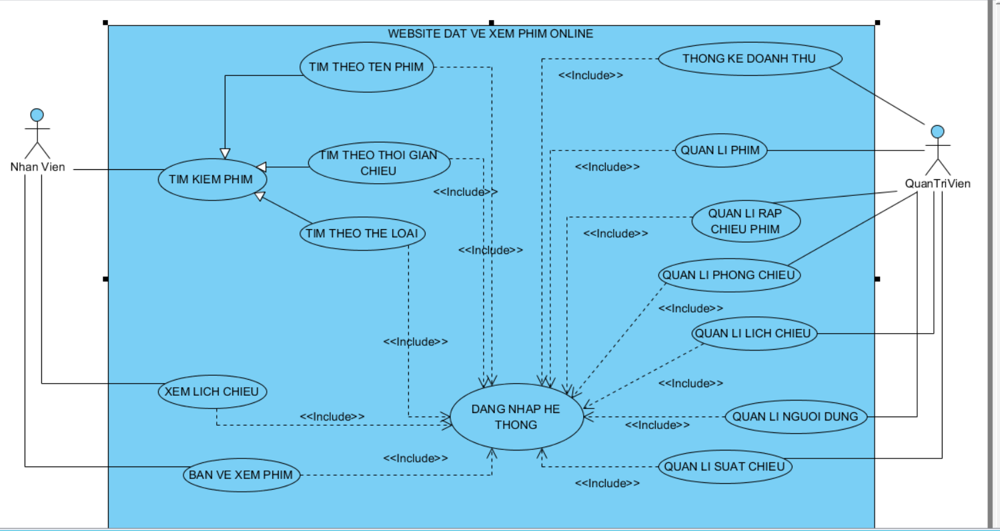

# Universe Cinema – Hệ thống quản lý rạp chiếu phim

**BA Portfolio** · Dự án học phần *Phát triển ứng dụng* · Trường Đại học Công nghiệp TP. Hồ Chí Minh (IUH) · 08/2024

---

## 1. Giới thiệu

**Universe Cinema** là hệ thống quản lý rạp chiếu phim do một nhóm 5 sinh viên phân tích trong học phần *Phát triển ứng dụng*. Hệ thống là **phần mềm bán vé tại quầy**: hỗ trợ nhân viên bán vé tại rạp (tìm phim, xem lịch chiếu, chọn ghế, thanh toán) và giúp người quản lí quản lý phim, rạp, phòng chiếu, suất chiếu, người dùng, đồng thời theo dõi doanh thu.

Repository này trình bày lại các tài liệu phân tích nghiệp vụ của dự án theo cấu trúc chuẩn của một Business Analyst: SRS, yêu cầu chức năng/phi chức năng, quy tắc nghiệp vụ, use case, quy trình, mô hình dữ liệu và ma trận truy vết. Mỗi nội dung đều được **truy vết về tài liệu gốc** và **gắn nhãn mức độ xác minh**.

## 2. Mục tiêu dự án

Theo tài liệu SRS của học phần, hệ thống hướng tới:

- Hỗ trợ quản lý thông tin và hoạt động của rạp chiếu phim dễ dàng, hiệu quả hơn.
- Giúp việc điều hành rạp nhanh chóng, thuận tiện và chính xác hơn cho người quản lý và nhân viên.
- Cung cấp báo cáo doanh thu, thống kê vé bán ra để tối ưu lịch chiếu và phân bổ phòng chiếu.
- Phục vụ rạp chiếu phim quy mô nhỏ đến trung bình, với giao diện thân thiện, không cần đào tạo chuyên sâu.

## 3. Vai trò và đóng góp cá nhân

| | |
|---|---|
| **Vai trò trong nhóm** | Thành viên nhóm 5 người, tham gia phân tích yêu cầu, viết tài liệu SRS (tham gia toàn bộ các mục) và thiết kế Use Case Diagram. |
| **Trong portfolio này** | Biên tập lại tài liệu theo bố cục SRS chuẩn; đánh mã và truy vết yêu cầu; review chất lượng tài liệu và lập danh sách mâu thuẫn; bổ sung (có đánh dấu) Activity Diagram, ERD đề xuất, quy tắc nghiệp vụ và NFR đề xuất. |

> Vai trò cá nhân do chủ portfolio xác nhận. Tài liệu học phần không có bảng phân công công việc để đối chiếu (xem [Q-09](08_Review/Assumptions_and_Open_Questions.md#3-câu-hỏi-cần-chủ-portfolio-xác-nhận-tbd)).

## 4. Các nghiệp vụ chính

| Nhóm nghiệp vụ | Actor | Use Case |
|---|---|---|
| Đăng nhập hệ thống | Nhân viên bán vé, Người quản lí | UC-001 |
| Tìm kiếm phim, xem lịch chiếu | Nhân viên bán vé | UC-002, UC-003 |
| **Bán vé xem phim** (chọn phim → chọn ghế → bắp/nước → thanh toán → in vé) | Nhân viên bán vé | UC-004 |
| Quản lý phim | Người quản lí | UC-005, UC-006, UC-007 |
| Quản lý rạp, phòng chiếu, ghế ngồi | Người quản lí | UC-008, UC-009 |
| Quản lý lịch chiếu, suất chiếu | Người quản lí | UC-010, UC-011 |
| Quản lý người dùng | Người quản lí | UC-012 |
| Thống kê doanh thu | Người quản lí | UC-013 |

**Một số quy tắc nghiệp vụ tiêu biểu:** không bán vé vượt số ghế còn trống (BR-002); mỗi suất chiếu gắn với một phòng chiếu cụ thể (BR-005); số ghế trống được cập nhật tự động sau mỗi giao dịch (BR-008); không hoàn, không đổi, không hủy vé sau khi thanh toán (BR-003, BR-004).

## 5. Danh sách tài liệu BA

| # | Tài liệu | Mô tả | Loại |
|---|---|---|---|
| 1 | [Project Overview](01_Project_Overview/Project_Overview.md) | Bối cảnh, mục tiêu, phạm vi, stakeholders, vai trò cá nhân | Biên tập lại + bổ sung |
| 2 | [Software Requirements Specification](02_Requirements/Software_Requirements_Specification.md) | SRS hợp nhất theo bố cục chuẩn | Biên tập lại |
| 3 | [Functional Requirements](02_Requirements/Functional_Requirements.md) | 35 yêu cầu chức năng FR-001 → FR-035 | Biên tập lại |
| 4 | [Non-functional Requirements](02_Requirements/Non_Functional_Requirements.md) | 8 NFR gốc + 7 NFR đo lường được (đề xuất) | Biên tập lại + đề xuất |
| 5 | [Business Rules](02_Requirements/Business_Rules.md) | 12 quy tắc gốc + 6 quy tắc đề xuất | Biên tập lại + đề xuất |
| 6 | [Use Case Catalog](03_Use_Case/Use_Case_Catalog.md) | Actor và 13 use case | Biên tập lại |
| 7 | [Use Case Specification](03_Use_Case/Use_Case_Specification.md) | Đặc tả use case; tách luồng gốc / suy ra / đề xuất | Biên tập lại + đề xuất |
| 8 | [Use Case Diagram](03_Use_Case/Use_Case_Diagram.md) | Sơ đồ gốc + bản vẽ lại PlantUML | Gốc + vẽ lại |
| 9 | [Activity Diagram](04_Business_Process/Activity_Diagram.md) | Quy trình đăng nhập, bán vé, thiết lập suất chiếu | Bổ sung cho portfolio |
| 10 | [Entity Relationship Diagram](05_Data_Model/Entity_Relationship_Diagram.md) | Mô hình dữ liệu khái niệm | **Đề xuất (PROPOSED)** |
| 11 | [UI Wireframes](06_UI_Wireframes/README.md) | 8 mockup giao diện gốc | Gốc (đã ẩn thông tin) |
| 12 | [Requirements Traceability Matrix](07_Traceability/Requirements_Traceability_Matrix.md) | FR ↔ UC ↔ BR ↔ Mockup | Bổ sung cho portfolio |
| 13 | [Source Traceability](07_Traceability/Source_Traceability.md) | Mỗi yêu cầu → tài liệu, mục, trang gốc | Bổ sung cho portfolio |
| 14 | [Assumptions and Open Questions](08_Review/Assumptions_and_Open_Questions.md) | 22 vấn đề, 5 giả định, 13 câu hỏi mở | Bổ sung cho portfolio |
| 15 | [Documentation Review Checklist](08_Review/Documentation_Review_Checklist.md) | Kết quả review tài liệu gốc và repo | Bổ sung cho portfolio |
| 16 | [UC-004 Detailed Specification](03_Use_Case/UC-004_Sell_Ticket_Detailed_Specification.md) | Đặc tả đầy đủ use case Bán vé: luồng chính, 4 luồng thay thế, 8 ngoại lệ | **Đề xuất (PROPOSED)** |
| 17 | [Test Cases – UC-004](09_Test_Design/Test_Cases_UC-004_Sell_Ticket.md) | 10 test case thiết kế cho Bán vé (chưa thực thi) | **Đề xuất (PROPOSED)** |
| 18 | [Case Study – Requirements Review](01_Project_Overview/Case_Study_Requirements_Review.md) | Cách rà soát và xử lý mâu thuẫn giữa hai tài liệu | Bổ sung cho portfolio |

## 6. Các sơ đồ phân tích

| Sơ đồ | Định dạng | Nguồn gốc | Xem |
|---|---|---|---|
| Use Case Diagram (gốc) | PNG | Sản phẩm học phần | [Xem](03_Use_Case/Use_Case_Diagram.md#1-sơ-đồ-gốc-của-học-phần-verified) |
| Use Case Diagram (vẽ lại) | PlantUML + PNG | Vẽ lại trung thực từ bản gốc | [Xem](03_Use_Case/Use_Case_Diagram.md#2-bản-vẽ-lại-bằng-plantuml-bản-sao-trung-thực) |
| System Context | Mermaid | Bổ sung (INFERRED) | [Xem](02_Requirements/Software_Requirements_Specification.md#2-system-overview) |
| Activity Diagram – Đăng nhập, Bán vé, Thiết lập suất chiếu | Mermaid | Bổ sung, tô màu theo mức căn cứ | [Xem](04_Business_Process/Activity_Diagram.md) |
| ERD | Mermaid | Đề xuất (PROPOSED) | [Xem](05_Data_Model/Entity_Relationship_Diagram.md) |

Xem trước sơ đồ Use Case gốc:

## 7. Kỹ năng BA thể hiện

| Kỹ năng | Thể hiện ở |
|---|---|
| Thu thập và phân tích yêu cầu từ tài liệu | Trích xuất 35 FR, 8 NFR, 12 BR từ 2 tài liệu nguồn |
| Viết tài liệu đặc tả (SRS, FR/NFR, BR) | [02_Requirements](02_Requirements/) |
| Mô hình hóa Use Case (UML) | [03_Use_Case](03_Use_Case/) |
| Mô hình hóa quy trình (Activity Diagram) | [04_Business_Process](04_Business_Process/Activity_Diagram.md) |
| Mô hình hóa dữ liệu khái niệm (ERD) | [05_Data_Model](05_Data_Model/Entity_Relationship_Diagram.md) |
| Truy vết yêu cầu (RTM) | [07_Traceability](07_Traceability/) |
| Review tài liệu, phát hiện mâu thuẫn và khoảng trống | [08_Review](08_Review/), [Case Study](01_Project_Overview/Case_Study_Requirements_Review.md) |
| Đặc tả use case chi tiết (luồng chính, thay thế, ngoại lệ) | [UC-004 Detailed Specification](03_Use_Case/UC-004_Sell_Ticket_Detailed_Specification.md) |
| Thiết kế test case từ use case và quy tắc nghiệp vụ | [Test Cases – UC-004](09_Test_Design/Test_Cases_UC-004_Sell_Ticket.md) |
| Diagram-as-code (Mermaid, PlantUML) | Các sơ đồ trong repo |
| Kiểm soát độ tin cậy của thông tin (VERIFIED / INFERRED / PROPOSED / TBD) | Toàn bộ tài liệu |

## 8. Tài liệu học phần và tài liệu bổ sung cho portfolio

Repo dùng nhãn thống nhất để người đọc phân biệt rõ đâu là sản phẩm học phần, đâu là phần làm thêm:

| Nhãn | Ý nghĩa |
|---|---|
| `VERIFIED` | Có căn cứ trực tiếp trong tài liệu học phần |
| `INFERRED` | Suy luận hợp lý từ tài liệu, chưa được xác nhận |
| `PROPOSED` / ⚠️ *Đề xuất bổ sung* | Viết thêm cho portfolio, **không phải sản phẩm của học phần** |
| `TBD` | Cần xác nhận (thường do tài liệu mâu thuẫn hoặc thiếu) |

| Thuộc học phần (biên tập lại, giữ nguyên nghĩa) | Bổ sung cho portfolio |
|---|---|
| Mô tả chức năng, phạm vi, NFR, actor, danh sách 13 use case, đặc tả UC001, Use Case Diagram, 8 mockup giao diện | Mã FR/NFR/BR, RTM, Source Traceability, Activity Diagram, ERD đề xuất, BR/NFR đề xuất, luồng UC đề xuất, đặc tả chi tiết UC-004, 10 test case thiết kế (chưa thực thi), case study, issue log, review checklist, bản vẽ lại PlantUML |

## 9. Ghi chú về tính học thuật của dự án

- Đây là **dự án học thuật**, không phải hệ thống thương mại đang vận hành. Tài liệu học phần không có thông tin về công nghệ, triển khai, kiểm thử hay người dùng thực tế. Repo này **không chứa** mã nguồn, link demo, kết quả kiểm thử hay số liệu vận hành.
- Số liệu trên mockup Dashboard là **dữ liệu minh họa**.
- Tài liệu học phần còn nhiều mục chưa hoàn thiện. Ví dụ: chỉ UC001 có đặc tả luồng đầy đủ, và hai tài liệu mâu thuẫn ở một số quy tắc. Repo **ghi nhận nguyên trạng** những điểm này thay vì tự sửa. Xem [Assumptions and Open Questions](08_Review/Assumptions_and_Open_Questions.md).
- Thông tin cá nhân của các thành viên nhóm và giảng viên (họ tên, mã số sinh viên, mã lớp) đã được loại bỏ. Poster phim thương mại trong mockup đã được che.
- Việc công khai tài liệu học phần đã được nhóm và giảng viên đồng ý (theo xác nhận của chủ portfolio).
- Tài liệu gốc (.docx) không được đưa vào repo.
